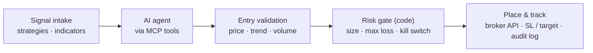
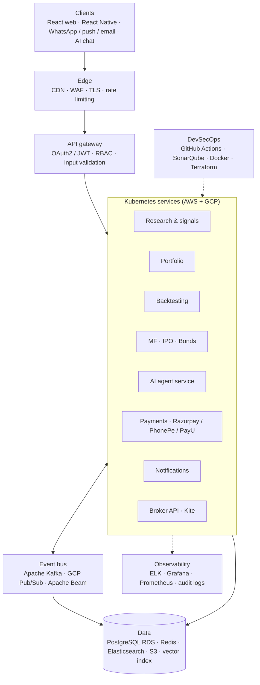
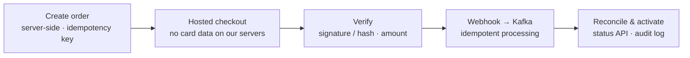

---

## 👋 About me

I'm **Boopalan Pichandi**, a **Full-Stack FinTech Architect** and **AI Agent Developer** based in Bengaluru with **5+ years** building regulated financial platforms. I design the architecture, implement the security and ship the product end-to-end, from React UI to Kubernetes, and the AI agents that turn market research into answers.

## 🏦 Currently: Architecting [RhoFi](https://rhofi.com)

**RhoFi Financial Technologies** · *Full-Stack FinTech Architect & AI Agent Developer* · Mar 2024 – Present

RhoFi is a **SEBI-registered research analyst platform** (`INH000025090`) for **stocks, F&O, mutual funds, IPOs and bonds**, with backtested strategies, AI-driven screeners and real-time market insights.

- 🏗️ **Architecture design**: event-driven microservices on AWS & GCP, Kafka / Pub/Sub market-data pipelines, PostgreSQL (RDS) + Redis, Kubernetes with zero-downtime releases
- 🛡️ **Security implementation**: OAuth2/JWT, RBAC, encryption in transit & at rest, managed secrets, WAF & rate limiting, audit logging, SAST and dependency scans in CI
- 💳 **Secure payments**: Razorpay, PhonePe and PayU behind one payment service, with server-side orders, signature/hash verification, verified idempotent webhooks and reconciliation
- 🚢 **End-to-end delivery**: React.js product UI, Python/Node services, Zerodha/Kite broker integration, CI/CD with **60% shorter** deployment cycles
- 🤖 **AI agents**: LLM research assistants with scoped read-only tools, retrieval and compliance guardrails

## 📡 Now building: MCP algo-trading agent *(in progress)*

An **MCP (Model Context Protocol) server** for algorithmic trading. It gives an AI agent typed, permissioned tools to read trade signals, validate entries and place orders through the broker API. Every order passes a risk gate that runs in code, outside the model.

| MCP tool | What it does |
|---|---|
| `get_signals` | Strategy signals per instrument and timeframe |
| `get_market_data` | Live quotes, OHLC candles and indicators |
| `validate_entry` | Confirms entry price, trend and volume before acting |
| `check_risk` | Position size, max loss and exposure limits |
| `place_order` | Order with stop-loss and target via Zerodha Kite (needs explicit permission) |
| `get_positions` | Open positions, P&L and order status |

Safety: separate read and order tools, server-side risk limits and a kill switch, paper-trading mode before live capital, broker tokens in a vault, and a full audit log.

## 🏗️ Platform architecture

## 🛡️ Secure system design

| Layer | Controls I implement |
|---|---|
| Identity | OAuth2/JWT, short-lived tokens with refresh rotation, role-based access |
| Data | TLS in transit; databases, backups and storage encrypted at rest |
| Secrets | Managed vault, runtime injection, rotation, secret scanning |
| Edge | WAF rules, rate limiting, request validation |
| Pipeline | SAST, dependency and container scans gating every merge |
| Compliance | Immutable audit trails and centralized logging that support SEBI obligations |
| AI | Read-only tools, scoped data access, prompt-injection filtering, disclaimers |

## 💳 Secure payment integrations

  
  &nbsp;&nbsp;&nbsp;
  
  &nbsp;&nbsp;&nbsp;
  

| Gateway | How I integrated it securely |
|---|---|
| **Razorpay** | Orders created server-side, checkout signature verified with HMAC-SHA256, webhooks verified via `X-Razorpay-Signature`, subscriptions and refunds |
| **PhonePe** | Server-to-server initiation, SHA-256 checksum on signed requests, callbacks verified, final state from the status-check API |
| **PayU** | SHA-512 request hash generated server-side, reverse-hash check on every response, verify-payment API for reconciliation |

Keys and salts live in a secrets vault, every transaction has an audit trail, and gateways can fail over without changing the product.

## 🤖 AI agent development

`intent detection → retrieval (RAG) → tool calls → guardrails → grounded response`

- Investor-facing research agent for portfolios, market mood and strategies
- LLM automation that speeds up analyst research workflows
- 📡 Now building an MCP server that exposes trading tools to an agent ([see above](#-now-building-mcp-algo-trading-agent-in-progress))
- 💬 **Try the live agent** on my portfolio: **[stackbyboopalan.github.io/#agent](https://stackbyboopalan.github.io/#agent)**

## 📈 Impact

| 60% | 50% | 99.9% | 40% | 35% |
|:---:|:---:|:---:|:---:|:---:|
| shorter deploy cycles (RhoFi) | faster releases (HawkMonk) | uptime SLA | lower MTTR | faster app responses |

## 🧭 Experience

- **RhoFi Financial Technologies**: Full-Stack FinTech Architect & AI Agent Developer *(Mar 2024 – Present)*
- **HawkMonk FinTech**: DevSecOps Engineer *(Nov 2022 – Feb 2024)*
- **HawkMonk FinTech**: Full Stack Developer *(May 2021 – Nov 2022)*
- 🎓 MCA, College of Engineering Guindy (Anna University) · B.Sc. Mathematics, Thiruvalluvar University

---

## 💻 Tech stack

**Architecture & Security**

**Payments**

**Frontend**

**Backend**

**Cloud & DevSecOps**

**Data, Streaming & Observability**

**AI / ML**

---

## 📊 GitHub activity

Most of my work is in private repositories of the RhoFi organization. My contribution graph counts that work without showing any code, repository names or details. Only my public repositories are visible here.

---

